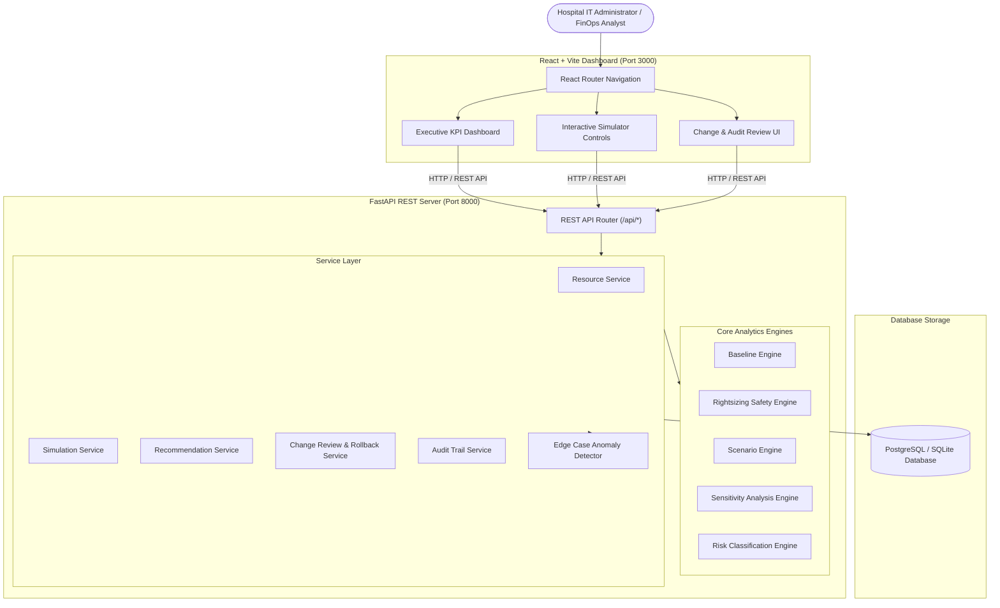

# Performance-Safe Cloud Rightsizing Simulator for Hospital Cloud Infrastructure

> **Disclaimer**: This system uses synthetic demonstration data and simulated pricing. Results are intended for evaluation, technical demonstration, and decision-support. **Simulation only — no production cloud infrastructure is modified.**

---

## 1. Executive Summary

Healthcare organizations store medical imaging (PACS), patient EHR records, clinical logs, and disaster recovery backups across multiple cloud accounts. Cloud infrastructure costs escalate when workloads are provisioned conservatively. However, blindly reducing instance sizes can lead to memory pressure, CPU saturation, latency degradation, request failures, and critical SLA violations.

This project delivers a **fully working software prototype** for a **Performance-Safe Cloud Rightsizing Simulator**. The system evaluates 90 days of historical workload patterns before recommending infrastructure changes, ensuring cost savings are achieved without damaging application availability or performance during peak hospital activity.

---

## 2. Key System Features

- **90-Day Synthetic Workload Dataset**: 17,000+ hourly data points across 8 core hospital department workloads (PACS Imaging, Patient Records API, Emergency API, Lab Results, Clinical Logs, Hospital Backup, Appointments, Billing).
- **Deterministic Rightsizing Engine**: Multi-stage evaluation checking vCPU capacity, RAM limits, latency queuing impact, and availability targets.
- **4 Operating Scenarios**: Evaluates rightsizing safety under Normal Workloads, Peak Hospital Activity, Bursty/Unpredictable Traffic, and Over-Provisioned Backup tasks.
- **Multi-Parameter Sensitivity Sweeps**: Identifies decision-changing threshold transitions (e.g. latency target changing decision from `SAFE TO RIGHTSIZE` to `REVIEW REQUIRED`).
- **Manual Override & Risk Acknowledgement**: Allows operators to override instance recommendations with mandatory justification logging.
- **Governance Approval Workflow**: High-risk recommendations require explicit authorization prior to simulated implementation.
- **Emergency Rollback System**: 1-click rollback functionality restoring previous instance state and cost structure.
- **Comprehensive Audit Trail**: Filterable event log with CSV export capability.
- **Full-Stack Implementation**: React 18 + Vite + Tailwind CSS + Recharts frontend backed by a Python FastAPI + SQLAlchemy REST API.

---

## 3. System Architecture



---

## 4. Tech Stack

- **Frontend**: React 18, Vite, TypeScript, Tailwind CSS, Recharts, Axios, Lucide Icons, React Router.
- **Backend**: Python 3.11/3.13, FastAPI, Pydantic v2, SQLAlchemy ORM, Pandas, NumPy, Scikit-learn.
- **Database**: SQLite (local zero-config) / PostgreSQL 15 (Docker container).
- **Testing**: Pytest, Pytest-Asyncio, HTTPX TestClient (22 automated tests).
- **Deployment**: Docker, Docker Compose, Nginx.

---

## 5. Quick Start Instructions

### Option 1: Docker Compose (Recommended)

```bash
docker compose up --build
```
- **Frontend Dashboard**: [http://localhost:3000](http://localhost:3000)
- **FastAPI Documentation**: [http://localhost:8000/docs](http://localhost:8000/docs)
- **Health Check**: [http://localhost:8000/api/health](http://localhost:8000/api/health)

### Option 2: Local Manual Setup

#### 1. Backend Setup
```bash
cd backend
py -m pip install -r requirements.txt
py seed_data.py
py -m uvicorn app.main:app --host 0.0.0.0 --port 8000 --reload
```

#### 2. Frontend Setup
```bash
cd frontend
cmd /c npm install
cmd /c npm run dev
```

---

## 6. Running Automated Tests

```bash
cd backend
py -m pytest
```

Expected output:
```text
====================== 22 passed in 2.64s =======================
```

---

## 7. Project Folder Structure

```text
hospital-rightsizing/
│
├── backend/
│   ├── app/
│   │   ├── main.py
│   │   ├── config.py
│   │   ├── database.py
│   │   ├── models/
│   │   ├── schemas/
│   │   ├── api/
│   │   ├── services/
│   │   ├── engines/
│   │   └── utils/
│   ├── tests/
│   ├── seed_data.py
│   └── requirements.txt
│
├── frontend/
│   ├── src/
│   │   ├── components/
│   │   ├── pages/
│   │   ├── services/
│   │   ├── types/
│   │   ├── App.tsx
│   │   └── main.tsx
│   ├── package.json
│   └── vite.config.ts
│
├── data/
│   ├── instance_catalog.csv
│   ├── pricing_history.csv
│   └── scenarios.json
│
├── deployment/
│   ├── Dockerfile.backend
│   ├── Dockerfile.frontend
│   ├── nginx.conf
│   └── docker-compose.yml
│
├── docs/
│   ├── architecture.md
│   ├── methodology.md
│   ├── testing.md
│   ├── ethics.md
│   └── deployment.md
│
├── README.md
└── docker-compose.yml
```

---

## 8. Ethics & Non-Clinical Scope Notice

This software prototype is built strictly for **cloud infrastructure optimization decision-support**. It does **NOT** make medical, clinical, or patient care decisions. All workload profiles and metric records originate from synthetic demonstration generators. No Protected Health Information (PHI) is processed or accessed.
