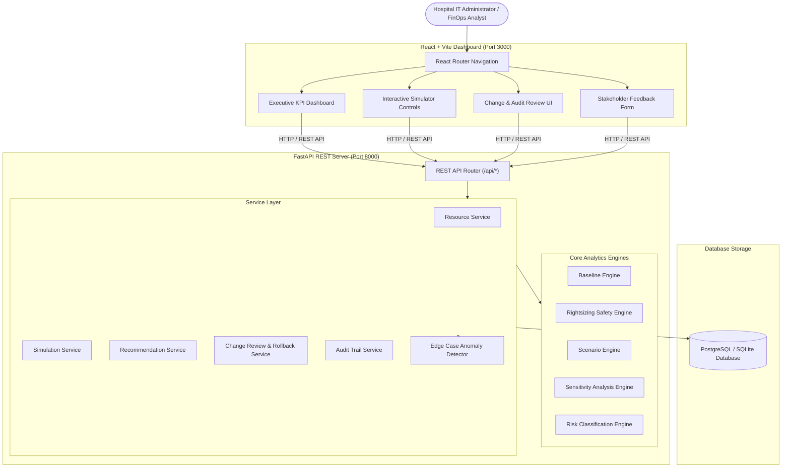

# System Architecture Document

## Performance-Safe Cloud Rightsizing Simulator for Hospital Cloud Infrastructure

This document details the architectural design, component interactions, database model, and safety enforcement mechanisms of the system.

---

## 1. System Architecture Overview

---

## 2. Component Descriptions

### 2.1 Frontend (React 18 + Vite + Tailwind CSS + Recharts)
- **Executive Dashboard**: Real-time KPI summaries, cost comparison charts, department savings breakdown, and audit event feed.
- **Rightsizing Simulator**: Interactive controls for selecting workloads, operating scenarios, candidate instance sizes, and threshold sliders (CPU, Memory, P95 Latency, Availability, Safety Headroom).
- **Scenario Comparison Matrix**: Side-by-side evaluation of candidate instances across Normal, Peak, Bursty, and Backup scenarios.
- **Sensitivity Analysis**: Multi-variable parameter sweeps identifying decision-changing threshold transitions.
- **Change Review & Governance**: Approval workflow for high-risk changes.
- **Emergency Rollback Path**: Restores original cloud instance configuration and decision state.

### 2.2 Backend (FastAPI + SQLAlchemy + Pandas + NumPy)
- **Baseline Engine**: Computes Mean, P95, P99, and Peak statistics for CPU, Memory, Request Volume, Latency, and Availability over 90 days.
- **Rightsizing Engine**: Predicts compute utilization and latency queuing delays for candidate instances. Enforces safety rules (`SAFE TO RIGHTSIZE`, `REVIEW REQUIRED`, `KEEP CURRENT INSTANCE`, `HIGH RISK`, `BLOCKED`).
- **Edge Case Anomaly Detector**: Flags missing metric gaps (>10%), sudden traffic spikes (>3.5x ratio), and pricing corruption.
- **Audit Service**: Records immutable log entries for all simulation runs, recommendation acceptances, manual overrides, approvals, and rollbacks.

### 2.3 Database Layer (PostgreSQL / SQLite)
- Supports SQLite out-of-the-box for zero-config local development and PostgreSQL inside Docker containers.
- Tables: `users`, `resources`, `metrics`, `instances`, `pricing_history`, `scenarios`, `simulations`, `recommendations`, `changes`, `audit_logs`, `feedback`.
